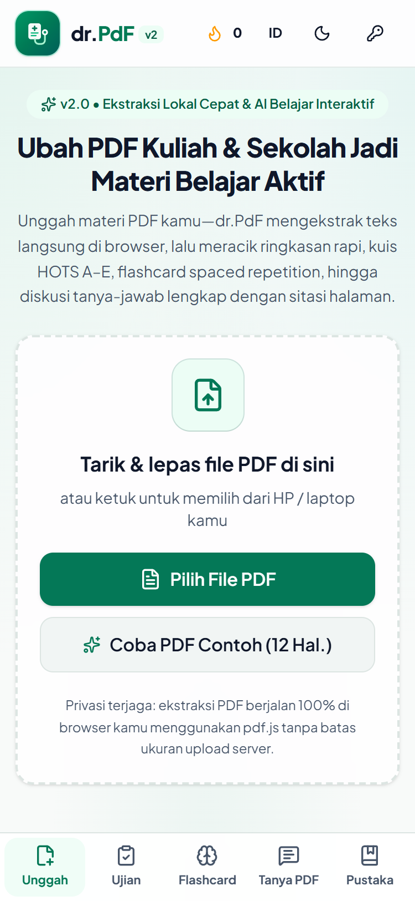
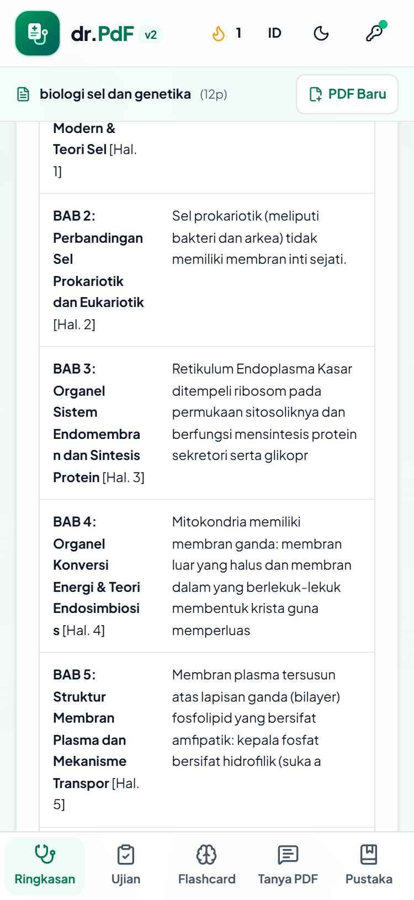
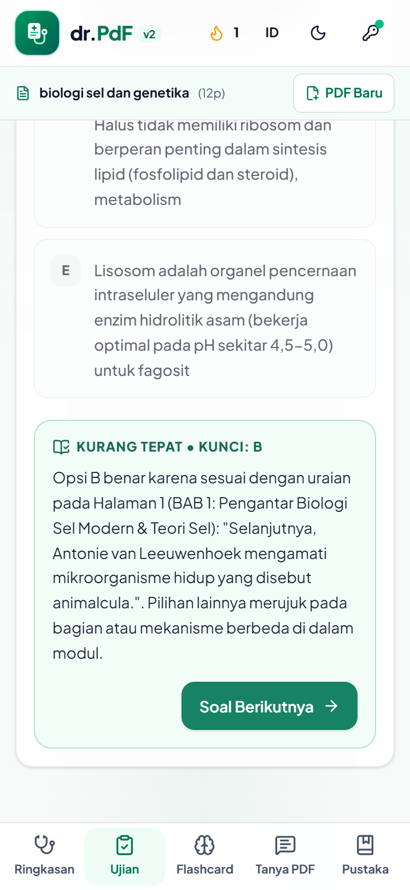
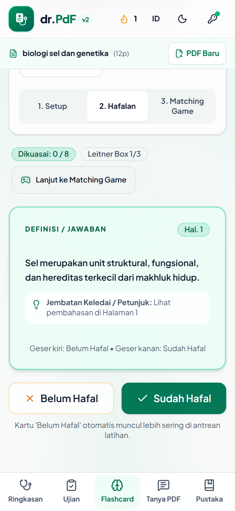
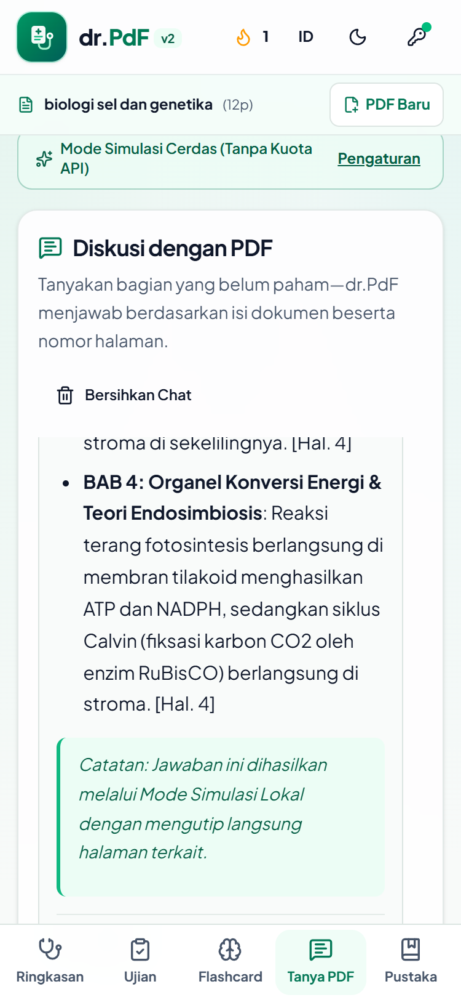
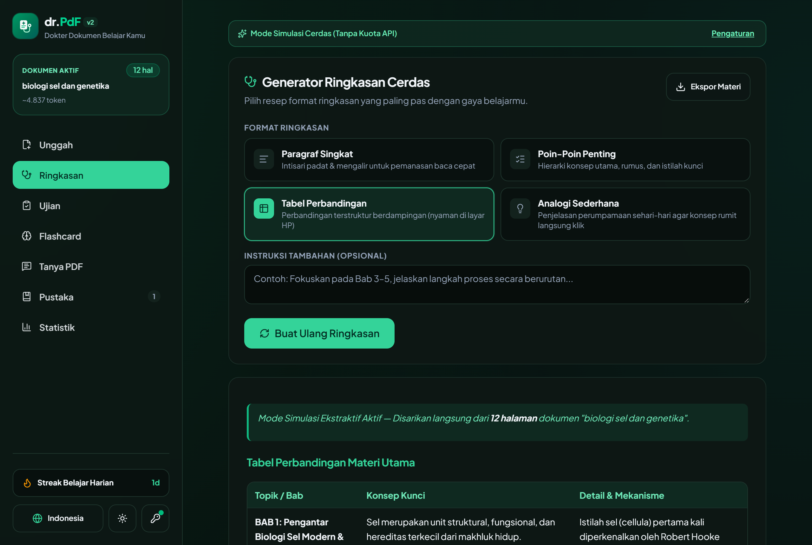

# 🩺 dr.PdF v2 — AI Study Assistant for Students

> **Evolusi dari Tugas Akhir Informatika Kelas XII:** Proyek ini merupakan penerus generasi kedua yang ditulis ulang sepenuhnya dari proyek portofolio akhir SMA saya ([rafarahman19/dr-pdf (v1)](https://github.com/rafarahman19/dr-pdf) berbasis Python & Streamlit) menjadi aplikasi web modern *mobile-first* berstandar produksi.

**dr.PdF v2** mengubah materi kuliah atau sekolah berformat PDF menjadi ruang belajar aktif: ekstraksi teks langsung di browser, ringkasan streaming rapi, kuis pilihan ganda A–E berlevel HOTS lengkap dengan remedial soal salah, flashcard *active recall* bersistem *spaced repetition* + *Matching Game*, diskusi tanya-jawab dengan sitasi halaman, hingga pustaka lokal *offline-ready* berbasis PWA.

---

## 📸 Tampilan Antarmuka (Screenshots)

| Unggah PDF (Mobile 375px) | Ringkasan Tabel (Mobile 375px) | Kuis A–E & Pembahasan |
| :---: | :---: | :---: |
|  |  |  |

| Flashcard 3D & Swipe | Tanya PDF + Sitasi Halaman | Desktop Dark Mode |
| :---: | :---: | :---: |
|  |  |  |

---

## ✨ Fitur Utama

### Paritas v1 yang Jauh Lebih Matang
1. **Ekstraksi PDF di Browser (`pdfjs-dist`):** Drag-and-drop & pemilih file ramah HP. Teks diekstrak halaman demi halaman langsung di perangkat pengguna (lengkap dengan progress bar, jumlah halaman, estimasi token, dan deteksi otomatis *scanned PDF* tanpa teks) sehingga file besar 10–50+ halaman tidak pernah menabrak batas ukuran upload server Vercel.
2. **Generator Ringkasan Streaming:** Empat mode (*Paragraf Singkat*, *Poin-Poin Penting*, *Tabel Perbandingan*, dan *Analogi Sederhana*) ditambah kolom instruksi bebas. Output di-stream secara *real-time* dalam Markdown bersih dengan tabel responsif di layar ponsel.
3. **Ujian Kompetensi Pilihan Ganda (Opsi A–E):** Tiga tingkat kesulitan (*Mudah*, *Menengah*, *Sulit / HOTS*), jumlah soal fleksibel, pembahasan instan di setiap soal, rekap skor akhir, serta tombol **"Ulangi Soal yang Salah Saja"** (*Remedial Mode*).
4. **Flashcard Active Recall + Spaced Repetition:** Alur 3 tahap (*Setup*, *Hafalan* kartu lipat 3D dengan gestur *swipe* kiri/kanan di HP, dan evaluasi *Matching Game*). Kartu yang ditandai *"Belum Hafal"* dijadwalkan ulang lebih sering di antrean Leitner Box.
5. **Ekspor Multi-Format:** Unduh hasil belajar sebagai **Markdown (`.md`)**, **Dokumen PDF Rapi (`.pdf`)**, atau **CSV Kompatibel Anki (`.csv`)**.

### Fitur Baru di v2
6. **Diskusi / Chat dengan PDF:** Tanya-jawab seputar isi dokumen secara streaming lengkap dengan kutipan nomor halaman interaktif (`[Hal. X]`) yang dapat diketuk untuk mengintip teks asli halaman tersebut.
7. **Pustaka Lokal & Riwayat (`IndexedDB`):** Tanpa perlu login—seluruh dokumen, ringkasan, kuis, flashcard, dan chat tersimpan di browser pengguna. Mendukung buka ulang, ubah nama (*rename*), dan hapus.
8. **Statistik Belajar:** *Daily streak* harian, grafik akurasi kuis per dokumen, serta jumlah flashcard yang telah dikuasai (*mastered*).
9. **Tema Gelap/Terang & Dwibahasa:** Mengikuti tema sistem secara otomatis dengan tombol pindah manual (*Light/Dark*), serta antarmuka Bahasa Indonesia (default) dan Bahasa Inggris (*English*).
10. **Progressive Web App (PWA):** Dapat di-install ke layar utama Android/iOS/Desktop, memiliki manifest & ikon lengkap, *app shell* memuat saat *offline*, dan seluruh materi tersimpan dapat dibaca tanpa internet.
11. **Opsi "Gunakan API Key Sendiri" (BYOK) & Mode Simulasi:** Pengguna dapat menyimpan kunci API Gemini pribadi di browser (`localStorage`) sebagai cadangan saat kuota gratis server habis.

---

## 🛠️ Tech Stack

- **Framework:** Next.js (App Router) + TypeScript (Strict Mode)
- **Styling & UI:** Tailwind CSS v4, komponen `shadcn/ui` berbasis Radix Primitives, `Plus Jakarta Sans`, `lucide-react`
- **Animasi:** `framer-motion` (mendukung `prefers-reduced-motion`)
- **AI Engine:** Google Gemini via SDK resmi terbaru `@google/genai` (`gemini-3.8-flash`), *Structured Output* (`responseSchema`) + validasi `zod`, serta strategi *Map-Reduce* otomatis untuk dokumen panjang
- **PDF & Ekspor:** `pdfjs-dist` (ekstraksi sisi klien), `jspdf` + `jspdf-autotable` (ekspor PDF terformat)
- **Penyimpanan Lokal:** `idb` (`IndexedDB`) + Service Worker (`public/sw.js`)

---

## 📂 Struktur Folder

```text
src/
├── app/
│   ├── api/ai/          # Server-side Route Handlers (summary, quiz, flashcards, chat)
│   ├── globals.css      # Design tokens, tipografi Markdown, & preferensi gerak
│   ├── layout.tsx       # Root layout, font Plus Jakarta Sans, metadata PWA
│   ├── manifest.ts      # Web App Manifest PWA
│   └── page.tsx         # Halaman utama
├── components/
│   ├── chat/            # ChatPanel + sitasi halaman interaktif
│   ├── export/          # ExportMenu (.md, .pdf, Anki .csv)
│   ├── flashcards/      # FlashcardPanel (Setup, 3D Flip/Swipe, Matching Game)
│   ├── layout/          # AppShell, BrandLogo, SettingsModal, Providers
│   ├── library/         # LibraryPanel & StatsDashboard
│   ├── pdf/             # PdfUploader + detektor scanned PDF
│   ├── quiz/            # QuizPanel (opsi A-E, HOTS, remedial soal salah)
│   ├── summary/         # SummaryPanel (4 format + streaming Markdown)
│   └── ui/              # Primitif shadcn/ui yang aksesibel
├── hooks/               # useAppSettings & useAiClient
└── lib/
    ├── ai/              # prompts.ts, schemas.ts, client.ts, chunker.ts, rate-limit.ts
    ├── i18n/            # Kamus Bahasa Indonesia & Inggris
    ├── pdf/             # Ekstraksi pdfjs-dist & generator file ekspor
    └── storage/         # IndexedDB CRUD & kalkulasi daily streak
```

---

## 🚀 Cara Menjalankan secara Lokal

1. **Clone repositori & masuk ke direktori proyek:**
   ```bash
   git clone https://github.com/rafarahman19/dr-pdf-v2.git
   cd dr-pdf-v2
   ```

2. **Install dependensi:**
   ```bash
   npm install
   ```

3. **Siapkan variabel lingkungan (`.env.local`):**
   Salin berkas `.env.example` menjadi `.env.local`:
   ```bash
   cp .env.example .env.local
   ```
   Isi `GEMINI_API_KEY` dengan kunci dari [Google AI Studio](https://aistudio.google.com/apikey):
   ```env
   GEMINI_API_KEY=AIzaSy...
   GEMINI_MODEL=gemini-3.8-flash
   ```
   > **Keamanan:** Jangan pernah menambahkan awalan `NEXT_PUBLIC_` pada `GEMINI_API_KEY` agar kunci rahasia server tidak pernah bocor ke *client bundle*.

4. **Jalankan server pengembangan:**
   ```bash
   npm run dev
   ```
   Buka `http://localhost:3000` di browser.

5. **Uji build produksi:**
   ```bash
   npm run lint
   npm run build
   npm run start
   ```

---

## ☁️ Cara Deploy ke Vercel (Free Tier)

1. **Push kode ke GitHub:**
   Pastikan `.env.local` tidak ikut ter-commit (sudah terlindungi di `.gitignore`), lalu push repositori ke akun GitHub kamu.
2. **Import Proyek di Vercel:**
   - Buka [vercel.com/new](https://vercel.com/new) dan pilih repositori `dr-pdf-v2`.
   - Framework Preset akan otomatis terdeteksi sebagai **Next.js**.
3. **Atur Environment Variable:**
   - Pada bagian **Environment Variables**, tambahkan:
     - `GEMINI_API_KEY` = *(API Key Google AI Studio kamu)*
     - `GEMINI_MODEL` = `gemini-3.8-flash` *(opsional)*
   - Klik **Deploy** dan tunggu ~1 menit hingga selesai.
4. **Menambahkan Custom Domain (Opsional):**
   - Buka dashboard proyek di Vercel → tab **Settings** → **Domains**.
   - Masukkan domain kamu (mis. `drpdf.namakamu.id`) dan klik **Add**.
   - Tambahkan record DNS sesuai instruksi Vercel (`A` record ke `76.76.21.21` untuk root domain, atau `CNAME` ke `cname.vercel-dns.com` untuk subdomain). Sertifikat HTTPS/SSL diterbitkan otomatis.
5. **Memverifikasi Instalasi PWA:**
   - Buka URL produksi HTTPS di **Chrome Android** atau **Chrome/Edge Desktop**.
   - Ketuk menu titik tiga Chrome → **"Tambahkan ke layar utama" / "Install app"** (atau gunakan tombol **Install Aplikasi** di menu Pengaturan `dr.PdF`).
   - Buka Chrome DevTools → tab **Application** → periksa **Manifest** (ikon `192x192`, `512x512`, & `maskable` terdaftar) serta **Service Workers** (`sw.js` berstatus *activated and is running*). Matikan koneksi jaringan (*Offline*) lalu muat ulang halaman untuk memastikan *app shell* dan pustaka tersimpan tetap dapat dibuka.
